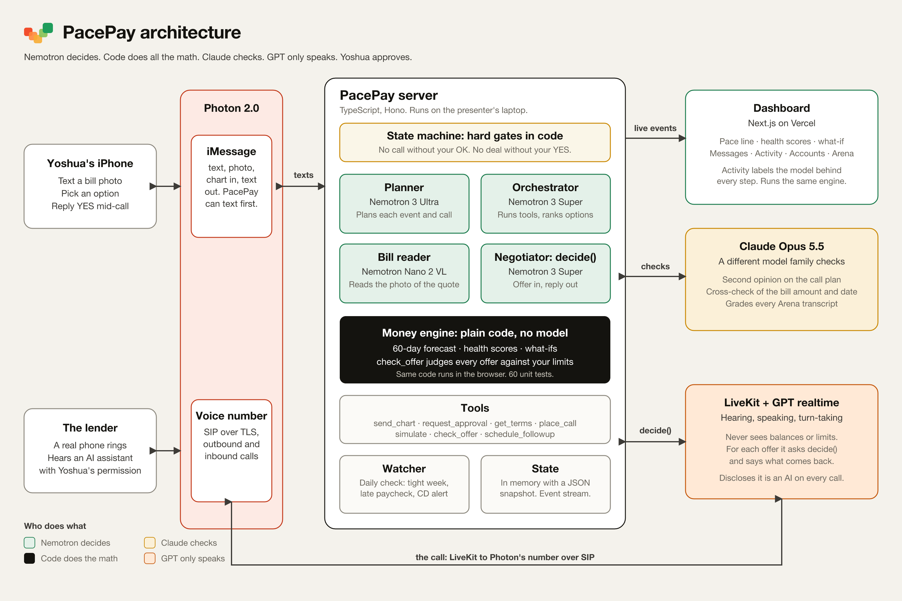

# PacePay

**See what you can afford. Get more time if you need it.**

PacePay is a money assistant you text like a friend. It sees all your accounts, forecasts the next 60 days, warns you before money gets tight, and, with your OK, calls whoever you owe to ask for more time. Built at HackUTD 2026 (ZeroDay) for the PNC, NVIDIA and Photon tracks.

**Try it:** [www.pacepay.work](https://www.pacepay.work) (the dashboard; the live demo runs on the presenter's laptop, so the site opens in demo mode unless it's connected). [Devpost write-up](docs/devpost.md) · [Negotiation arena transcripts](docs/arena-transcripts.md)

## The idea in one scene

The shop quotes $650 for brakes. You text PacePay a photo of the quote. It reads the bill and sends a chart: paying today puts checking at **−$300 on Tuesday**, because the mortgage and the car payment land before Thursday's paycheck. It texts three options and a pick. You choose "ask the lender to move the car payment," and set your limits ($100 checking floor, $1,500 savings floor, $25 max in fees).

PacePay calls the lender, says it's an AI assistant calling with your permission, and negotiates. The lender offers Wednesday, still before payday, so it asks for Friday without saying why. They settle on **Friday for $20**. Mid-call your phone buzzes with the exact terms, you reply YES, and only then does PacePay confirm out loud. The forecast turns green.

Every offer is judged by code against your limits, and every line PacePay says on the call is written by code, so the voice never sees your balances and can't improvise.

## How it works



- **The money engine is plain code** ([`packages/engine`](packages/engine)): forecast, health scores, what-ifs and offer checks. Deterministic, 60 unit tests, and it runs in the browser too. No model ever calculates a number.
- **Nemotron decides:** Nemotron 3 Ultra plans each event, Nemotron 3 Super runs the tools, and Nemotron Nano 2 VL reads bill photos. On a call, our negotiator code picks every reply; Super only steps in, with a cap, for a lender line the code can't read.
- **Claude checks:** Claude Opus 5.5 gives a second opinion on the call plan, cross-checks the bill, and grades the negotiation arena.
- **GPT only listens:** OpenAI GPT realtime (`gpt-realtime-2.1`) hears the lender over LiveKit (turn detection and transcription). Every PacePay line is written by the negotiator code and spoken by OpenAI TTS (`gpt-4o-mini-tts`, voice marin), so the voice can only say what code hands it.
- **Photon 2.0** carries the iMessage conversation (through its REST API, on a shared iMessage line; PacePay's name and photo come from a contact card, [`design/brand/pacepay.vcf`](design/brand/pacepay.vcf)) and the phone line.
- **Code enforces the gates:** no call without your pick and your OK on the limits, no deal without your YES. PacePay never agrees to anything but exactly what you approved: if the lender changes the terms afterward, the approval is void, and the Done text goes out only after the call ends with an undisputed deal.
- **Tested against bad calls:** a call simulator ([`scripts/stress/`](scripts/stress)) plays 363 adversarial lender personas against the real call loop, and code rules plus a Claude judge check every transcript.

## Repo map

| Path | What's in it |
|---|---|
| [`packages/engine`](packages/engine) | The money engine and the demo household |
| [`packages/shared`](packages/shared) | Types, schemas and message templates shared by every app |
| [`apps/dashboard`](apps/dashboard) | The Next.js dashboard: pace line, health scores, what-if, Messages, Activity, Accounts, Arena |
| [`apps/server`](apps/server) | The agent, negotiator, Photon bridge and tools (Hono, TypeScript) |
| [`apps/voice`](apps/voice) | The LiveKit voice worker for phone calls |
| [`design/`](design) | Logo, brand files and the printed repair-quote prop |
| [v2.md](v2.md) · [SPEC.md](SPEC.md) · [UI.md](UI.md) | The product plan, the build spec and the design notes |

## Run it

You can run the dashboard by itself with no keys. It runs the engine in the browser and walks you through the whole repair case step by step.

```bash
pnpm install
pnpm --filter @pacepay/dashboard dev     # http://localhost:3000, demo mode
pnpm -r test                             # engine, shared, server and dashboard tests
pnpm -r typecheck
```

Press **Ask my lender**, then **Call now**, and step through the call. Then **Skip to Wed, Nov 18** to see the unprompted CD alert. The moon switches to Night.

The full system (real texts and calls) needs API keys that stay on the presenter's machine: Photon, LiveKit, OpenAI and the model gateways. Setup is below. Without the paid keys the server runs in NVIDIA mode, with every Nemotron role on a shared NVIDIA key.

## The team

Yoshua ([bforce541](https://github.com/bforce541)) built the money engine, the dashboard and the brand. Ram ([ramsarma21](https://github.com/ramsarma21)) built the agent, the negotiator, the voice and the Photon bridge.

---

## Deploy

Every push to `main` deploys to **https://pacepay.work** through Vercel (project `pacepay` on Yoshua's Vercel account, connected to this repo). Nobody needs to run a deploy command.

- Vercel builds `apps/dashboard` (Next.js) from the pnpm workspace. A push that changes nothing in `apps/dashboard` or the packages it uses (docs, for example) skips the build.
- `www.pacepay.work` serves the site, and `pacepay.work` redirects to it. DNS is at Porkbun: an A record for `@` and a CNAME for `www`, both pointing at Vercel.
- Builds fail with "root directory does not exist" until `apps/dashboard` lands. That's expected.
- The repo has to stay public: on Vercel's Hobby plan, pushes from anyone but Yoshua only deploy from a public repo.
- The deployed dashboard can't reach a server on `localhost`. To show live data on pacepay.work, give the server a public URL (for example a tunnel on `api.pacepay.work`) and set `SERVER_URL` in the Vercel project's environment variables. Otherwise demo the dashboard locally.

## Setup

This repo is public, so every key lives in `.env` **encrypted** with [dotenvx](https://dotenvx.com). You need one file to unlock it.

1. Get `.env.keys` from Ram over DM and save it in the repo root. It's gitignored. Never commit it or paste it anywhere public.
2. Check that your keys work:

   ```bash
   npx @dotenvx/dotenvx run --convention=nextjs -- node scripts/check-keys.mjs
   ```

3. Run anything with the keys loaded by putting `npx @dotenvx/dotenvx run --convention=nextjs --` in front of the command. That flag also loads a personal, gitignored `.env.local` if you have one.

Two keys are **not** in `.env`: the TrueFoundry gateway key and the OpenAI key. They stay on Ram's machine in `.env.local`. Without them, the server runs in NVIDIA mode, with every Nemotron role on the shared NVIDIA key ([SPEC.md › 5.4](SPEC.md#54-models-and-timeouts)). Real phone calls only work on Ram's machine. Who builds what is in [SPEC.md › 10](SPEC.md#10-workstreams-and-tasks).

To add or change a setting, run `npx @dotenvx/dotenvx set NAME value` (it encrypts automatically), then commit `.env`. Keep every value encrypted, even model names: a plain-text value makes git refuse the commit on machines that ran `dotenvx protect`. `.env.example` lists every setting and where to get it.

Before committing `.env`, run `npx @dotenvx/dotenvx protect`. It fails if any secret is in plain text. The key check above flags plain-text secrets too.
