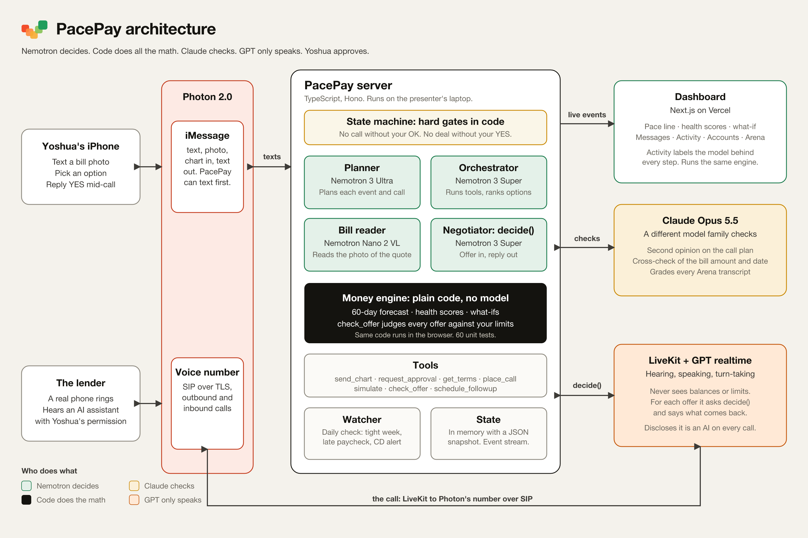

# PacePay

**See what you can afford. Get more time if you need it.** A money assistant you save as a contact. It texts you before money gets tight, and with your OK, calls whoever you owe to fix it.

> Placeholders still open before submitting are marked `[ARENA]`, `[BILLS]` and `[PIN]`. Everything else is checked against the code and v2.md. See "Open placeholders" at the bottom.

## Inspiration

A checking balance tells you what you have today. It takes more work to figure out what you'll have left after rent, automatic payments and whatever else is due before payday. And if the timing doesn't work, you still have to work out what to move and make the call.

Most money apps stop at the chart. We wanted one that acts. So we built the dashboard, and an agent that acts on what the dashboard finds.

## What it does

PacePay shows how a bill or purchase would affect your cash over the next 60 days, compares your options, and can call a lender on your behalf to ask for more time. You set the limits and approve the final terms by text.

**Know what happens after you pay.** The dashboard shows your accounts, net worth and upcoming cash flow. Try a purchase before committing to it, see when your checking balance would hit its lowest point, and ask the coach what's driving the dip. Or just text PacePay a photo of a bill or quote: it reads the amount and checks it against your forecast. You might cover it from savings, put it on a credit card, or ask to move a payment. Each option shows how it changes the forecast, so you pick the trade-off.

**Ask for more time without making the call yourself.** If you choose to negotiate, you approve who PacePay calls, what it asks for and the most you'll pay in fees. PacePay talks through dates and fees with the person on the line, checks each offer against your forecast and counters while keeping your balances and limits private. When an offer fits your limits, it texts you the exact terms while the lender is still on the line, and waits for your yes before confirming out loud.

### The demo, start to finish

Yoshua is our demo household. He has eight accounts: checking, savings, a CD, a Roth IRA, a car loan, a personal loan, a credit card and a mortgage. His rules: keep $100 in checking, keep $1,500 in savings, pay no more than $25 in fees.

1. The shop quotes $650 for brakes. Yoshua texts PacePay a photo of the quote, with no question.
2. PacePay reads the bill, replies right away, and sends a chart of the week: checking hits **−$300 on Tuesday** if he pays today, because the mortgage and the car payment land before Thursday's paycheck.
3. It texts three options, with a pick and a reason. Yoshua replies "1": ask the lender to move the car payment to Friday.
4. Yoshua OKs the limits. PacePay gets a second opinion on the plan from a different model family, then calls the lender.
5. On the call it says it's an AI assistant calling with Yoshua's permission, and that the call is transcribed. The lender offers Wednesday. PacePay declines without giving a reason (Wednesday is still before payday) and asks for Friday. They settle on **Friday for $20**.
6. Mid-call, Yoshua's phone buzzes: "They'll move it to Fri, Nov 13 for $20. Approve?" He replies YES and PacePay confirms on the call.
7. A done text lands in the thread. Checking stays at $100 or above and the forecast turns green.
8. Unprompted, PacePay points out that Friday only works if Thursday's paycheck lands (if it's late, checking hits −$320 on Friday) and offers to watch for it. When Yoshua says the paycheck really is late, it recalculates and shows the options again, call first.
9. Later, also unprompted: the $5,000 CD matures Fri, Nov 20. PacePay compares paying off the card ($2,214) and moving the other $2,786 to savings against renewing. Paying off the card saves about $550 a year.

PacePay never moves money or agrees to anything final without Yoshua's yes.

## How we built it

The dashboard, coach and negotiator share one TypeScript money engine. It calculates projected balances, scores and what-ifs, and checks every offer against the user's limits. It is plain code with 60 unit tests, and it also runs in the browser, so the what-if panel updates instantly. **No model ever calculates a number.** Models read things in (a photo, what a lender said) and decide what to do; the engine does the math.

| Piece | Model or tool | What it does |
|---|---|---|
| Money engine | None. Plain code. | Daily balances, health scores, what-ifs, `check_offer`. Deterministic and unit-tested. |
| Planner | Nemotron 3 Ultra | Writes the step plan for each event, plans calls, writes the CD advice |
| Orchestrator | Nemotron 3 Super | Carries out the plan with tools and ranks the options |
| Call decisions | Nemotron 3 Super | Turns every lender response into dates and fees, then decides the reply through a `decide` tool |
| Bill reader | Nemotron Nano 2 VL | Reads bill photos. Claude cross-checks the amount and due date. |
| Second opinion | Claude Opus 5.5 | A different model family checks the call plan against Yoshua's rules before PacePay dials |
| Arena grader | Claude Opus 5.5 | Grades every simulated negotiation transcript |
| Simulated lenders | Nemotron 3 Ultra | Plays 50 lender personalities |
| Call voice | OpenAI GPT realtime (`gpt-realtime-2.1`) via LiveKit, on a Photon number | Hearing, speaking, turn-taking |
| Messaging | Photon 2.0 | iMessage texts, options, approvals, chart images, bill photos |
| Dashboard | Next.js, Radix UI, visx | Live updates over server-sent events. Activity tab shows which model or tool did each step. |
| Charts in texts | Rendered from engine data | Never AI-generated, because numbers in a picture have to be exact |

Nemotron makes every decision. Claude checks and grades. GPT is only the voice. Code does the math.

**On lender calls the voice model never sees balances or limits.** It knows Yoshua's name, the loan reference and the line Nemotron hands it. For every offer it calls Nemotron's `decide` tool and says what comes back.

**Code enforces the hard gates:** no call without Yoshua's pick and his OK on the limits, no deal without his yes, and every offer goes through `check_offer`. A payment on payday counts as risky by rule, because the deposit might land after the payment.

## PNC: 360° Financial Health Navigator

| PNC asks for | How PacePay does it |
|---|---|
| The whole picture | One household with all eight accounts and net worth |
| 3+ health indicators | Four scores (cash cushion, emergency fund, credit use, debt-to-income), each with a goal, a one-line reason and how to improve |
| Forecast balances and obligations | 60-day daily forecast with every bill and paycheck |
| A "what if" simulator | What-if panel in the dashboard, and what-ifs by text |
| A conversational coach | The same assistant in iMessage, on calls and in the dashboard |
| Confidence in the next move | Options with trade-offs across accounts, a pick with a reason, approval before anything happens |
| Something no one has thought of | PacePay negotiates the due date on a real call and checks each offer live |

## NVIDIA: Use Nemotron Beyond a Chatbot

| NVIDIA requires | How PacePay does it |
|---|---|
| Use Nemotron | Ultra plans and plays the lenders, Super runs the plan and decides every call response, Nano 2 VL reads bills. Every Activity step is labeled with its model. |
| Beyond a chatbot | It acts on events, not prompts: a bill photo with no question, a daily check that catches the maturing CD, a watch on a late paycheck. It places real phone calls. |
| Multi-step workflows | For the repair: shortfall → options → pick → loan terms → call plan → limits OK → second opinion → call → judge each offer → mid-call approval → confirm → update forecast → follow-up |
| Tool integration | Photon, LiveKit and GPT realtime, the forecast engine, a TrueFoundry gateway, Claude, a scheduler |
| Real-world applicability | Overdrafts and late fees are common, and lenders do move due dates |

Patterns covered: multi-agent (planner, orchestrator, negotiator, bill reader, lender simulator, reviewer), agentic RAG (the planner decides whether it needs a loan's fine print), ReAct (the negotiator calls `check_offer` and picks its reply from the result), multimodal (bill photos), and simulation and eval (the Arena).

## Photon: Build a messaging agent on Photon 2.0

| Photon rewards | How PacePay does it |
|---|---|
| Live on a Photon channel | An iMessage line for texts and a Photon number for calls |
| Best Voice Agent | PacePay places real calls to the lender over LiveKit through the Photon number. [PIN] Inbound calls are PIN-gated: numbers are read out only after the caller's PIN. |
| Human-in-the-loop | Yoshua picks the option, OKs the limits before the call, and approves the deal mid-call by text |
| Context across time and channels | The call summary lands in the thread, and PacePay keeps rules, past decisions and the late-paycheck watch in context |
| A delightful default | Quiet unless the forecast crosses a floor, one-word replies, a chart instead of a wall of text |
| Safety and fallbacks | AI disclosure on every call, offers read back, a 60-second approval timeout, a reference number for the lender's records, and a text mode if a call fails |

## Arena results

We ran simulated lenders (cooperative, fee-pushing, stubborn on dates, vague, flat refusal, identity check, chatty). Nemotron 3 Ultra played each lender, PacePay's negotiator answered over text, and Claude graded every transcript.

| Result | Value |
|---|---|
| Runs | [ARENA] |
| Deals reached | [ARENA] |
| Limit violations | [ARENA] |
| Balance or limit disclosures | [ARENA] |
| Offers read back | [ARENA] |

Flat refusals and identity checks end without a deal by design. Every transcript is published in `docs/arena-transcripts.md` and clickable in the dashboard's Arena tab.

## Bill reader accuracy

We generated 30 test bill photos with known amounts and due dates (phone photos at an angle, crumpled, low light, thermal receipts) and measured the reader against the answers: [BILLS]

## Challenges

- **No model does math.** Every number comes from the engine. Models only read numbers in, and PacePay confirms each one with Yoshua.
- **Real calls are noisy.** On our first real call, background noise could sound like a reply, and the call could end before the goodbye finished. We made the agent state the ask up front, ignore line noise, and wait for the goodbye before hanging up.
- **Two conversations at once.** The agent has to keep the lender on the line while giving Yoshua time to read the terms and answer. We settled on a short, varied filler only when a lookup is slow, and a 60-second approval window.
- **Payday timing.** Whether a Thursday payment posts before or after that morning's deposit depends on the bank. The engine counts deposits first, but still rejects any payday offer as risky by rule, so both Wednesday and Thursday get pushed back to Friday.
- **Keeping secrets on a call.** The voice model can't leak a balance it never receives.
- **A $35 fee is affordable but not allowed.** PacePay pushes back without revealing the limit.

## Accomplishments

- Real texts and real phone calls on a Photon number, driven by the same engine as the dashboard
- A dashboard and an agent on the same data and the same calculator
- Charts in iMessage that are exact, because they come from the engine
- Every offer on a call judged by code, in under a millisecond, with the lender never learning a balance
- Simulated negotiations with published transcripts: [ARENA] limit violations and disclosures

## What we learned

- Measure before swapping models. We tried Nemotron Nano for call decisions and it skipped the tool call in testing, so Super took that seat.
- Gates in code beat instructions in prompts. The calling rules live in a state machine, not a prompt.
- A different model family makes a better reviewer: Claude checks the plan and grades the Arena, so Nemotron never grades Nemotron.
- Short texts with a pick and a reason get faster replies than a wall of options.

## What's next

The prototype uses a sample household with eight accounts.

- **Real accounts:** connect a bank with permission through Plaid, and verify that an agreed payment change actually shows up on the account. If a payment is still scheduled for the original date, PacePay could flag it before the money comes out.
- **Household mode:** a partner gets the same summaries and can approve.
- **Spanish:** PacePay talks to the user in Spanish while negotiating with the lender in English.

## Built with

Nemotron 3 Ultra, Nemotron 3 Super, Nemotron Nano 2 VL, Claude Opus 5.5, OpenAI GPT realtime, GPT Image 2, LiveKit Agents, Photon 2.0, TrueFoundry, build.nvidia.com, TypeScript, Node, Hono, Zod, Next.js, React, Tailwind, Radix UI, visx, Vitest, Vercel

## Open placeholders

- `[ARENA]`: paste the numbers after Ram's rerun (his script writes `apps/dashboard/public/demo/arena-results.json`; `docs/arena-transcripts.md` has the table).
- `[BILLS]`: the bill reader's accuracy. No results file is in the repo, so ask Ram for the count and the due-date accuracy, and say how many photos were code-drawn and how many AI-generated.
- `[PIN]`: confirm with Ram that a real inbound PIN call has worked. If not, delete that sentence.
- Confirm "Real texts and real phone calls" still reads true after the phone run, and add "photo to done text on real phones" if it worked end to end.
